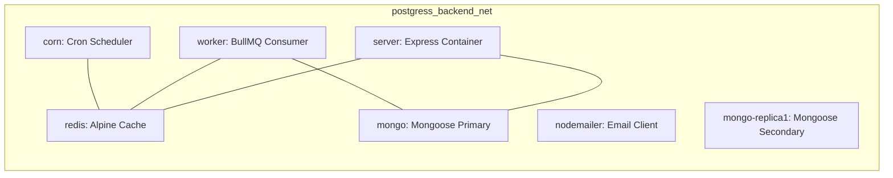

# Deployment & Container Configuration

This document covers Docker container setups, environment dependencies, database replica networks, and deployment procedures.

---

## 1. Docker Compose Stack

The stack defines isolated networks and persistent volumes to build and connect all services securely.



### Network Isolation
All containers communicate through the dedicated bridge network `postgress_backend_net`. External port access is limited:
- **Server**: Exposes port `5000` to direct hosts.
- **MongoDB**: Primary exposed on port `27018` localhost, Secondary on `27019` localhost.
- **Redis**: Exposed on port `6379` localhost.

---

## 2. MongoDB Replica Set Initialization

To support transaction actions and Mongoose change-streams, the MongoDB cluster must run as a **Replica Set**.

1. **Authentication**: Handled via shared keyfile `/data/configdb/mongo-keyfile` generated by entrypoint scripts inside containers.
2. **Setup Helper (`mongo-init`)**: A one-shot initialization container running `mongosh` checks availability and triggers:
   ```javascript
   rs.initiate({
     _id: "rs0",
     members: [
       { _id: 0, host: "mongo:27017", priority: 2 },
       { _id: 1, host: "mongo-replica1:27017", priority: 1 }
     ]
   });
   ```
3. **Connection String**: Used by services to handle reads/writes with high availability:
   `mongodb://<user>:<password>@mongo:27017,mongo-replica1:27017/postgress_backend?authSource=admin&replicaSet=rs0&readPreference=secondaryPreferred`

---

## 3. Environment Variables Reference

Environment configurations reside locally in service subdirectories. Do not combine them into a root file.

| Service | Environment File | Crucial Variables |
| :--- | :--- | :--- |
| **server** | [server/.env](file:///c:/bdcalling/explore/postgress-backend/server/.env) | `MONGODB_URI`, `REDIS_HOST`, `JWT_ACCESS_TOKEN_SECRET_KEY`, `OTP_HASH_SECRET`, `SMTP_USER`, `S3_BUCKET_NAME` |
| **worker** | [worker/.env](file:///c:/bdcalling/explore/postgress-backend/worker/.env) | `MONGODB_URI`, `REDIS_HOST`, `REDIS_PASSWORD` |
| **corn** | [corn/.env](file:///c:/bdcalling/explore/postgress-backend/corn/.env) | `MONGODB_URI`, `REDIS_HOST`, `REDIS_PASSWORD` |

---

## 4. Volume Persistence

Named volumes are declared at the bottom of the Compose file to retain databases and cache data across container resets:
- `mongo_data`: Standard DB directories.
- `mongo_config`: Database configuration directories.
- `redis_data`: Redis memory snapshots.
- `worker_node_modules`, `corn_node_modules`: Anonymous caching of dependency installs inside the container.
